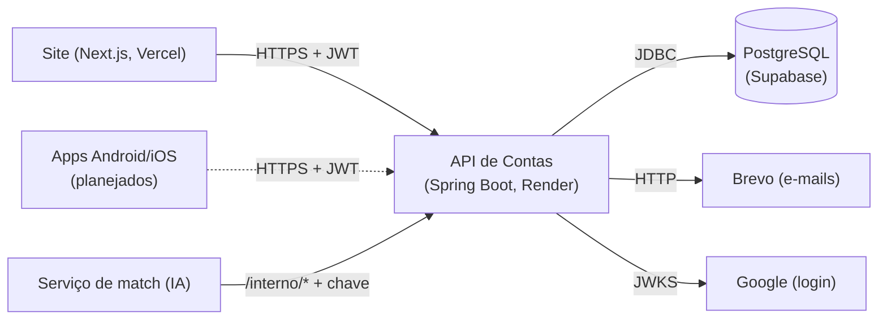

# JobAI — API de Contas


API REST em **Java 21 + Spring Boot 4** que cuidava das contas do **JobAI**, um site feito por um time de 3 pessoas.

## A ideia do JobAI

Procurar emprego toma tempo: abrir vários sites, filtrar, ler vaga por vaga e descobrir se ela combina com você.
O JobAI queria **automatizar essa busca para qualquer área e qualquer nível de experiência**, do primeiro
emprego ao profissional experiente.

1. O usuário criaria a conta e preencheria o perfil: área, nível, cidades onde quer trabalhar, modalidade
   (presencial, remoto, híbrido), habilidades, idiomas.
2. O sistema buscaria vagas automaticamente em vários sites, e uma IA compararia cada vaga com o perfil.
3. O usuário receberia as vagas que combinam com ele, cada uma com a **porcentagem de compatibilidade**,
   **por que combina** e **o que falta** para ele ser um candidato mais forte.

Ou seja: o usuário **não precisaria procurar vaga nenhuma**, só receber as que fazem sentido e se candidatar.
O modelo de negócio era **assinatura mensal**. O plano Grátis mostrava 3 vagas por semana, e os planos
pagos liberavam mais vagas e a análise completa do "o que falta".

Eu fui o **responsável pelo back-end e pelo banco de dados**. O front-end (Next.js) e a parte de IA
(cálculo do match) ficaram com os outros dois integrantes.

> O projeto foi encerrado em novembro de 2026. Veja [Por que o projeto parou](#por-que-o-projeto-parou).

---

## O que a API faz

- **Contas e login**: cadastro com e-mail e senha, login com Google, sessões por dispositivo (web, Android, iOS).
- **Perfil profissional**: momento de carreira, áreas, níveis, modalidades, cidades, escolaridade, habilidades, idiomas.
- **Feed de vagas com match**: recebe as vagas e o resultado do match (porcentagem, por que combina, o que falta)
  e entrega para cada usuário seguindo as regras do plano.
- **Plano Grátis com limite**: 3 vagas liberadas por semana (de segunda a domingo, horário de Brasília),
  sem a seção "o que falta", que era exclusiva do plano pago.
- **Recuperação de senha e confirmação de e-mail** com links de uso único enviados pela API da Brevo.
- **LGPD**: registro de aceite dos termos (sem guardar a idade), exportação de todos os dados da pessoa em JSON,
  exclusão completa da conta e limpeza automática de dados que não servem mais.

## Tecnologias

| Área | O que usei |
|---|---|
| Linguagem e framework | Java 21, Spring Boot 4.1, Spring Security, Spring Data JPA (Hibernate 7) |
| Banco de dados | PostgreSQL 17 (Supabase), migrações versionadas com Flyway, Row Level Security |
| Autenticação | JWT (access token de 15 min) + refresh token rotativo, BCrypt, login com Google (verificação do ID token) |
| E-mail | API HTTP da Brevo (o plano grátis do Render bloqueia SMTP) |
| Testes | JUnit 5, MockMvc, Mockito, PostgreSQL real em banco separado |
| CI/CD | GitHub Actions (testes a cada push), Docker multi-stage, deploy automático no Render |

## Arquitetura



O código é organizado **por funcionalidade** (`auth`, `perfil`, `vaga`, `plano`, `senha`, `confirmacao`,
`exportacao`, `limpeza`...), e não por camada técnica. Assim, tudo o que é de "esqueci minha senha", por
exemplo, fica num lugar só.

## Decisões que valem destacar

- **Refresh token rotativo, guardado só como hash (SHA-256).** Cada refresh token funciona uma única vez.
  Se vazar e for usado, o token antigo já não vale. Trocar ou redefinir a senha derruba as sessões em
  todos os dispositivos.
- **Respostas que não revelam quem tem conta.** Login com e-mail inexistente e com senha errada devolvem o
  mesmo erro, e "esqueci minha senha" responde sempre igual.
- **Limite de tentativas.** Depois de 5 senhas erradas em 15 minutos, o login fica bloqueado (HTTP 429).
- **Proteção contra conta "reservada".** Se alguém cria uma conta com o e-mail de outra pessoa e não
  confirma o e-mail, quando a dona do e-mail entra com o Google a senha do intruso é apagada e as sessões
  dele caem.
- **Regras do plano aplicadas no servidor**, nunca só no site. A exportação de dados (LGPD) segue as mesmas
  regras, para não virar um jeito de ver de graça o que é pago.
- **Rotas internas separadas** (`/interno/*`) para o serviço de IA, protegidas por chave e com
  comparação em tempo constante.
- **Migrações nunca editadas depois de aplicadas.** Toda mudança no banco é um arquivo novo (V1 a V8).

## Testes

São **38 testes de integração**: sobem a API inteira e conversam com um PostgreSQL de verdade, como o site
faria. Eles cobrem cadastro, login, bloqueio, sessões, recuperação de senha, confirmação de e-mail, login
com Google (com um dublê do Google), plano Grátis, rotas internas, exportação, exclusão de conta e limpeza
do banco.

Eles rodam no GitHub Actions a cada push e já pegaram um bug real: no Linux, a melhor vaga da semana
aparecia por **último** no plano Grátis. As vagas liberadas juntas recebiam horários com microssegundos
de diferença, e a ordenação por horário invertia a lista. No Windows, onde o relógio é menos preciso, o
teste passava. A correção foi dar o mesmo horário a todas as vagas liberadas juntas.

## Como rodar

Precisa de Java 21 e PostgreSQL. Crie um banco `contas_teste` e a variável `DB_PASSWORD_TESTE` com a senha do
PostgreSQL. Depois:

```bash
./mvnw test             # roda os 38 testes
./mvnw spring-boot:run  # sobe a API (veja as variáveis em docs/API.md)
```

A documentação completa das 26 rotas, do banco e da configuração está em **[docs/API.md](docs/API.md)**.

## Por que o projeto parou

O JobAI dependia de reunir vagas de vários sites. Na prática, a maioria dos sites de vagas bloqueia a
leitura automatizada, e coletar mesmo assim iria contra os termos de uso deles. Os poucos que oferecem
API oficial têm poucas vagas. Sem uma fonte de vagas legítima e com volume, o time
decidiu encerrar o projeto.

A lição que fica: **validar a fonte de dados antes de construir o produto em volta dela.**

## O que aprendi

- Modelar um banco relacional e evoluí-lo com migrações sem quebrar o que já estava no ar.
- Autenticação de verdade: JWT, refresh token, hash de senha, login social, limite de tentativas.
- LGPD na prática: minimização de dados, consentimento, portabilidade e exclusão.
- Colocar uma API no ar com Docker e variáveis de ambiente, sem nenhum segredo no código.
- Escrever testes automatizados e usar CI para pegar bugs antes dos usuários.
- Trabalhar em time: contrato de API com o front, rotas para o serviço de IA, branches e revisão antes da `main`.

## Sobre o desenvolvimento

Desenvolvi este back-end **com o auxílio de IA (Claude, da Anthropic)**, que aparece como coautora em boa
parte dos commits. Eu definia o que fazer, testava cada parte no meu computador antes de ir para a `main`,
cuidava da infraestrutura (Supabase, Render, Brevo, Google Cloud) e das decisões com o time.
